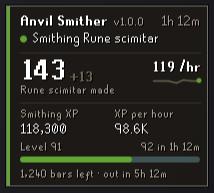

# Anvil Smither

Smiths bars into items at an anvil next to a bank, at **Varrock west** or **Prifddinas south**, banking every load. Makes Sailing keel parts too.

Authors: **StickToTheScript**, **chsami**, **Igor**, **George M**, **irkedMATT**

## What you need
- The Smithing level for the item you pick. It is checked when you start, and the message tells you the level you need.
- Bars in the bank. For Large keel parts: regular Keel parts of that metal, not bars.
- A hammer in the bank, in your inventory or worn. A plain hammer or an Imcando hammer (main-hand or off-hand) works.
- Prifddinas south needs Song of the Elves. Keel parts need Pandemonium. Dart tips need The Tourist Trap.
- Recommended: wear an Imcando hammer. It frees a slot, so every load holds one more bar.

## How to start
1. Stand at the bank you picked. The plugin walks between that bank and its anvil; it does not travel between cities.
2. Choose the location, the bar and the item.
3. Turn the plugin on.

## What it does
- Banks whatever you are carrying, then takes out a full load of bars and a hammer if you are not wearing one.
- Wears an Imcando hammer you are carrying.
- Sets the anvil quantity to All, picks the item, and presses space to repeat it on later loads.
- Carries on after a level-up message, a disconnect or a world hop.
- Logs back in after a disconnect or the 6-hour logout, after a short pause. Not when you log out yourself, not during a break (the break handler logs back in), and not when the Auto Login plugin is on. Needs a login profile in the Microbot profile panel; gives up after 10 tries.
- With **Alch what was made** on, alchs the items once the bars run out.
- Stops with the reason when the bars or the hammer run out, and can log out.
- Stops trying after five failed attempts in a row and says what to check.

## How it plays
Each session draws its own habits, so two sessions do not behave the same: how quick its reactions are, how often it is watching when a load ends, and how often the cursor moves while it smiths.
- Sets the camera once so the bank and the anvil are both in view, and leaves a view that already shows both.
- Reactions are never instant and never on a fixed beat.
- After a load it is usually back within a second or two, sometimes several seconds, now and then longer.
- Most loads the cursor stays where it was. Some loads it rests over the bank, or leaves the game window.
- Now and then it uses the next booth or anvil along.
- Works with Break Handler and Break Handler V2: a break waits until the load on the anvil is finished, then starts. Pauses for the client's pause button too.
- Waits for the client to click Play on the welcome screen before doing anything.
- Takes a short break after a load now and then, but only when micro breaks are on in the Antiban panel and the Break Handler is on.

## Settings
- **Location**: Varrock west or Prifddinas south.
- **Bar**: the bar to smith with. For keel parts this also picks the keel's metal.
- **Item**: what to make.
- **Alch what was made**: when the bars run out, takes the items of that kind out of the bank as notes and casts High Alchemy on them (Low Alchemy below 55 Magic). It takes every one of that item in the bank. Needs nature runes, and fire runes or a fire staff: in the bank, a rune pouch or worn. The game warns before alching anything worth 1,000 coins or more: raise "Minimum item value needed for Alchemy spells warning" (All Settings, Warnings) above your item, or the alching stops at the warning. Keel parts and stackable items (nails, dart tips, arrowtips, knives, bolts) are never alched.
- **Log out when finished**: log out when it stops because the bars or the hammer ran out.
- **Detailed log**: write every decision to the log. Turn it on for a bug report.
- **Info panel**: the session panel, Full, Compact (one line) or Off. Right-click the panel to switch size.

## Items
Every metal: dagger, sword, scimitar, long sword, 2-hand sword, axe, mace, warhammer, battle axe, claws, chain body, plate legs, plate skirt, plate body, nails, medium helm, full helm, square shield, kite shield, dart tips, arrowtips, knives, bolts (unf) and crossbow limbs.

One metal only: bronze wire (bronze), iron spit and oil lantern frame (iron), steel studs and bullseye lantern (unf) (steel). Picking one with another bar is refused when you start.

## Sailing keel parts

| Metal | Smithing | Keel parts | Large keel parts |
|---|---|---|---|
| Bronze | 10 | 5 bronze bars | 5 Bronze keel parts |
| Iron | 22 | 5 iron bars | 5 Iron keel parts |
| Steel | 38 | 5 steel bars | 5 Steel keel parts |
| Mithril | 56 | 5 mithril bars | 5 Mithril keel parts |
| Adamant | 74 | 5 adamantite bars | 5 Adamant keel parts |
| Rune | 86 | 5 runite bars | 5 Rune keel parts |

Large keel parts are made from regular keel parts, not bars, so make and bank the regular ones first. Dragon keel parts of either size are made at the Dragon Forge, so they are not offered.

## Locations

| | Varrock west | Prifddinas south |
|---|---|---|
| Walk | 10 tiles | 8 tiles |
| Needs | nothing | Song of the Elves |

## Panel
Shows what it is doing, items made and the load in progress, items per hour with a trend line for the last two hours, experience gained and per hour, progress and time to the next Smithing level, and the bars left with how long they will last. Rates show `-` for the first minute. Right-click the panel for the one-line size; hold Alt to drag it.

## Known limits
- Spears, hastae, javelin heads, the mithril grapple tip and gold or silver items are not offered.
- It does not smelt bars or buy them.

## Disclaimer
For the Microbot RuneLite client only. Automation is against Jagex's rules and can get an account banned. Use at your own risk.

## Changelog
### 1.0.0
First release as Anvil Smither, built on the Varrock Anvil plugin.
- Prifddinas south added beside Varrock west.
- Sailing keel parts and large keel parts.
- Imcando hammer, carried or worn.
- Smithing level checked per item, not per bar; one-metal items are refused with the wrong bar.
- Optional alching of what was made once the bars run out.
- Logs back in after a disconnect or the 6-hour logout.
- Works with Break Handler and Break Handler V2, and the pause button.
- Per-session habits, natural reaction times and a new panel.
