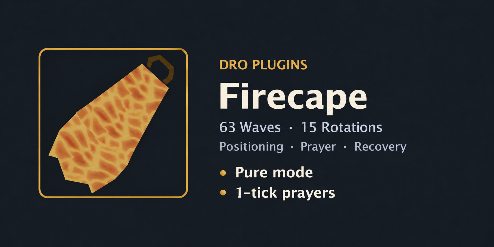
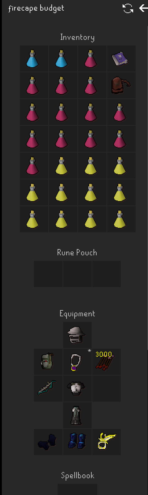
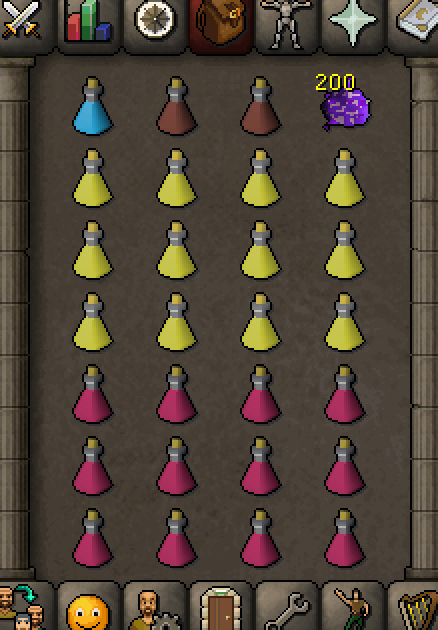
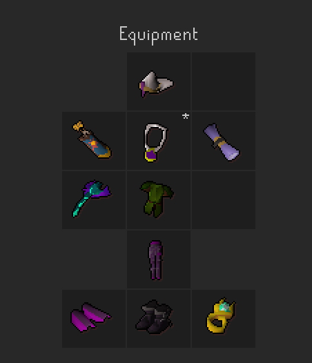
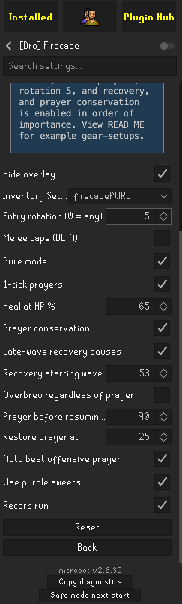

# [Dro] Firecape

**Free and open source.** DRO provides this plugin without a purchase, subscription or paid license key. Original DRO contributions use the [BSD 2-Clause license](https://opensource.org/license/bsd-2-clause). Redistributed source and binaries must retain the DRO copyright, license conditions and disclaimer; existing third-party notices also remain applicable.

Automated Fight Caves for Microbot: all **63 waves and 15 rotations**, TzHaar travel, banking, equipment, positioning, protection prayers, potions and supported thralls. Version **0.3.71**, requiring **Microbot 2.6.30**.

**There is no guarantee of a Fire cape. Better gear and adequate supplies improve the chances. Test under supervision.** Normal ranged mode has completed capes; Pure has substantial live testing but no confirmed completed cape in the retained evidence.

## Quick start

1. Create and select an **Inventory Setup** with your intended equipment and supplies. Stock the matching items in the bank and check ammunition, weapon charges and spell prerequisites.
2. Choose the settings below. Fresh startup requires at least 43 base Prayer, a recognized weapon and immediate prayer-restoration supplies.
3. Start the plugin. It prepares the interface, travels to TzHaar, banks and gears up, then enters the cave. Avoid other plugins that compete for controls.
4. Keep **Record run** enabled. Review the status during rotation waits and recovery pauses.

Fresh startup sets zoom to 150 and disables auto-retaliate; it no longer changes keybindings (tabs open through the client). Starting inside an active cave uses the resume path instead of repeating bank preparation, so restarting inside the cave continues the same Fire cape attempt. **Start at entrance** skips banking, the Inventory Setup and the ranging pre-dose: it checks the carried weapon and prayer potions, walks to the entrance, waits for the rotation and enters. Get another cape still banks for each later run. When the TzHaar grouping teleport is on cooldown or does not land, travel uses the Microbot walker to TzHaar, for up to 5 minutes. The built-in spawn predictor supports fresh entry; installing another FC Spawn Predictor is not required. Entry rotation `0` accepts any calibrated rotation; `1–15` waits for that rotation on the current world.

## Controller, input and prayers

The pure controller is the only controller: conservative positioning, cover preservation and trapped-monster handling, with Jad handled inside it. Restart after changing recovery settings.

| Fight input | Behavior |
|---|---|
| Natural mouse (default) | Every cave action is a menu action carried by a Natural mouse travel and press. |
| Direct invokes | Every cave action (prayers, attacks, supplies, specials, spells, run, logout, exit) is sent to the client directly. |

Walking always uses the Natural mouse in both modes. Each action re-checks its target at delivery (NPC still alive, item still in its slot, prayer still in the wrong state), so a stale action is dropped instead of sent.

A tab (inventory, spellbook, prayer, equipment) is not changed until the game has read the last mouse press, for at most 150 ms (Colosseum 1.0.80 failsafe), so a press can never land on the next panel.

| Play mode | You do | The script does |
|---|---|---|
| Normal | Nothing | Everything, including entry, banking and travel. |
| Manual movement | Walking in the cave | Prayers, attacks, Ancient magic switches, potions, sweets and the blowpipe special, with direct invokes. No lures, rock cover, spacing, escape steps or camera turns. Attacks wait while you walk and go only to a monster in range and sight of your tile, so they never move you; with Jad, untagged healers in reach are tagged first. Banking, travel and entry stay automatic. |
| Prayers only | Everything else | Protection and offensive prayers inside the cave only, with direct invokes. Takes precedence over Manual movement. |

Prayers are lazy-flicked as in the Inferno and Colosseum plugins. Every hit is protected on its own tick; only attacks that truly land on the same tick force a choice, in this order: Magic, then a big melee, then Range, then small melees. As in the Colosseum, only the most certain hits are weighed: an attacker whose clock is known beats one that is due only because its clock is not calibrated yet, except a big melee or Ket-Zek in contact, which always counts. A Tok-Xil or Ket-Zek beside you only melees, so it is protected with Melee, also while running past it, unless another monster can attack with its ranged or magic style on the same tick. Protection is switched **on the tick before each predicted hit and off on the next tick**; it is not held through a verified gap. One matching attack interval calibrates a ranged or magic NPC; a melee monster in contact is calibrated by its first swing, and Protect from Melee is never pre-armed for movement or held for a melee monster that is not in contact. No prayer is used between waves. Movement pre-arms Range or Magic only when that attacker can reach its range during the move, and a melee-only demand never delays an attack. Bats are shot at once without waiting for a prayer input window. A guard that must stay up (an uncalibrated or late attack clock, a nearby blob split, Jad) is 1-tick flicked: every active prayer is toggled off and back on early in each tick, so the hold does not drain Prayer. The cave is entered with every combat prayer off. The best offensive prayer for the weapon is chosen automatically and switched on the tick before each of your shots and off on the shot tick, once two shots have shown the weapon's speed, and only at a big melee, ranger, mager (not while another monster is attacking you), Jad or healer, never at bats or blobs: Rigour/Deadeye/Eagle Eye and lower for ranged, Augury/Mystic Might (or Vigour)/Lore/Will for magic, Piety/Chivalry or Strength + Attack when a melee weapon is equipped. Direct invokes 1-tick every active prayer; Natural mouse 1-ticks only when a single prayer is held. This does not guarantee protection from simultaneous attacks or zero Prayer drain.

**Magic switches.** When you are on the Ancient spellbook with the level and runes for Ice or Blood Burst, Blitz or Barrage, the script casts from the tile the planner already chose (it never walks for a spell; with Manual movement, from wherever you stand), in this order:

1. Magers (Magic level 240, the highest magic defence in the cave) and Jad are never spell targets, and no spell is cast during Jad. Rangers, blobs, melees and bats are.
2. Ice stops a monster coming at you in the open (untrapped, unfrozen, not yet in contact): a bat always first (its hits drain prayer even through Protect from Melee), then a big melee, then a big blob, then a split blob with another split blob beside it. Only with Ice runes; Blood likewise needs its own runes.
3. Blood only heals: it starts below 90% HP and stops at 95%. A clump (another monster touching the target, inside the 3x3 splash) is preferred for the bigger heal; otherwise a trapped monster (it cannot hit you, so the heal is free while the overhead flicks for the others), then a ranger, then the nearest blob, melee or bat in reach. No safespot is needed. While the switch is worn, spells own attacking: no regular attack (or wand autocast) goes out until the main set is back.

The spell is selected and cast on the monster in one direct action in both input modes, because a prayer click clears a selected spell. Gear is labelled the Colosseum way (1.0.82): the best carried magic weapon by rank (Kodai, ancient sceptres, master wand, Blue Moon spear, ancient staff, then by stats), then the best carried piece per slot by magic attack plus three per magic damage percent, with prayer breaking ties. A void mage helm beats any helm, and with the Blue Moon spear the Blue Moon helm, chestplate and tassets win their slots. Pieces without game stats fall back to the Colosseum table (imbued god capes, occult, god books, mage's book, defenders, fury) and then to their name. Every piece goes on in one burst, weapon first; a two-handed weapon never takes an offhand, and a piece clicked in the last 1.2 seconds is never clicked again. A piece still not worn after four requests is set aside for 25 ticks, or for the rest of the run when the switch's weapon is on and only that piece stays off. Legs and other pieces stay on for Blood (the cave's magic defence is low). Gear only comes off into a free inventory slot: no two-handed swap over a worn offhand without one. The one exception: when your main two-handed weapon (a bow, for example) can't go back on because the switch's book or shield has no free slot, the Saradomin brew with the fewest doses is dropped to make room. It is never picked up again; dropped items despawn. The pieces you wore before go back once no spell is wanted, on a clear wave and before Jad or a wave-pause logout. Big melees and Ket-Zek have a 40% water weakness since 25 June 2025; whether Ancient Ice spells count for it is unconfirmed.

**Specials.** Magic shortbow (i) 50% (55% unimbued), Armadyl crossbow 50%, Dragon crossbow 60% and Zaryte crossbow 75% are used on big targets (never bats, split blobs or healers); the Rosewood blowpipe (25%) on any target; the Toxic blowpipe (50%) when at least 8 HP is missing, since it heals. Costs are from the OSRS Wiki "Special attacks" table.

## Magic weapons

Staves, wands, sceptres and powered staves are detected from the Inventory Setup; no setting is needed. Powered staves (trident, sanguinesti, Tumeken's shadow and similar) cast their built-in spell at 7 tiles. A staff or wand keeps a spell you already set to autocast; otherwise the best castable **Ice** spell (Ancient) or **Water** spell (standard) is selected through the Combat tab before entry, at 10 tiles. Bring the runes for it.

## Example normal ranged setup

Use the pictured budget setup. Save the equipment and inventory together as an Inventory Setup. Better equipment can reduce fight duration and supply use.

## Example Pure setup

For the recommended Pure example, bring **150+ purple sweets**, choose **rotation 5**, and enable **recovery**, in that order of importance. Enable Use purple sweets as well.

The inventory below contains **200 sweets**. Save it together with the equipment in one Inventory Setup. These examples do not change defaults or guarantee completion.

The configuration example uses 65% healing, recovery from wave 53, 90% Prayer before resuming, and overbrew off. Recording is enabled.

## Healing, supplies and recovery

| Setting | Default and behavior |
|---|---|
| Heal at HP % | 60%; adjustable. The controller normally heals to a recovery buffer rather than repeatedly topping up to full. |
| Restore prayer at | 25. Confirmed brew consumption may also require a super restore to repair combat stats. |
| Use purple sweets | Off. When enabled and carried, heal to full during clear gaps or verified settled traps. Emergency healing takes priority. |
| Late-wave recovery pauses | Off. Request the end-of-wave pause once, finish the wave, recover, then world-hop to resume automatically. No Jad pause request. |
| Recovery starting wave | 56. Also requires HP at 70% or below and the safety gates. |
| Overbrew regardless of prayer | Off. Waves 53+: an eligible full boosted-HP batch once per wave; also applies during late paused recovery. Restores stats afterward. |
| Prayer before resuming % | 90%; separate from the ordinary restoration threshold. |

Recovery considers HP, stats, Prayer and 40% run energy. The depleted-supply continuation policy avoids waiting indefinitely for absent recovery consumables. Missing supplies still reduce the chance of surviving; watch warnings and remaining resources.

Ranged pre-potting consumes an available full potion before entry, banks the partial potion and withdraws a full replacement. Stock an extra full potion for that refill. In-cave boosts wait until Ranged falls to base and preserve **three doses before wave 53**, then **one for Jad**. A reserved potion may remain untouched intentionally.

Supported blowpipe healing specials and castable thralls are automatic. They require suitable action windows and resources; a healing special is not used at full HP. Thralls are not newly summoned during Jad/healer handling. Purple sweets require settled safety and are not ordinary active Jad healing.

## Jad and healers in .66

Jad protection takes priority over tags, attacks and supplies. The Pure-ranged repair confirms tags across the living healer group, checks a north collection route, observes following, then checks south-side terrain separation and firing access before resuming Jad attacks. Temporary body-blocking alone is not a verified trap. Lost tags, new healers, unsuitable geometry, interrupted ownership or renewed Jad healing can cancel the sequence.

This conditional sequence is for exposed, untrapped Jad. An already terrain-trapped Jad retains existing handling. The normal controller does not use the new Pure-ranged sequence. The exact .66 healer changes still need supervised live acceptance testing.

## Recordings and manual control

The run is always recorded (there is no setting): `events.jsonl` plus matching `collision-*.csv` are saved under `~/.runelite/dro-firecape/YYYYMMDD-HHMMSS-SSS/`. These are telemetry and collision maps, not video. Each hit on the player is logged with its attacker (`player-hit`: NPC, style, attack tick, prayer on the attack and landing ticks, cause). Retain the whole folder when reporting an issue, along with version, settings, loadout, wave and any manual intervention.

Users are highly encouraged to share complete Fight Caves recordings with **DRO** to help improve the plugin.

Hide overlay affects visibility only. Taking manual control or pausing can suspend automatic prayer input; maintain protection yourself while doing so.

## Live test history

The retained evidence includes **29 main-mode combat segments across 17 versions**, **14 early Pure-development segments**, and **six identifiable later Pure attempts**. Restarts and overlapping logs are not independent full runs.

| Version | Milestone |
|---|---|
| .21 / .22 | Main runs reached waves 55 / 58 during early combat refinement. |
| .27 | First main cape, October 3; manual approach to Jad was needed before the script finished. |
| .29 | Second main cape, October 5; smoother reported startup and completion. |
| .31 | Archived normal-mode baseline before Pure development. The public Hub now shares common runtime classes; original normal-controller method bodies were compared during extraction. |
| .57 | Pure reached wave 56 on an 80 Ranged, 75 HP, 1 Defence account; wave-22 ranger stall needed a manual attack and supplies ran out. |
| .59 / .60 | One tester-reported build-swap attempt; retained frames reach 53 with the .59 label. |
| .61 / .62 | Retained frames reach 40 / 53; movement exposure, supply use and recovery stalls informed repairs. |
| .63 | Two clips cover waves 21–55 of one attempt. |
| .65 | Pure reached Jad after clearing 1–62; healer handling and remaining supplies prevented a confirmed Pure cape. |
| .66 | Pure completed wave 59 and continued into partial wave 60. The wave-22 ranger freeze required manual rescue; the last restore was consumed on wave 58. No completed Pure cape. |
| .69 | Rotation 5 Pure reached partial wave 57. Wave 22 completed in about 68 seconds without the earlier freeze. Brews ran out on wave 56; restores and sweets remained. Most of the extra damage versus .66 was concentrated in waves 42 and 51. |

The tester considers .65 close to completion with another brew and successful healer trapping. That is an assessment, not a recorded Pure cape. The later six attempts have eight event files: one .59 file overlaps another, and .63 has two parts. No separate complete .58 or .64 attempt is attested. Full recordings, conversation archives and detailed analysis stay in the owner's separate backups.

## Build and verification

Version .69 adds bounded rejection memory and pursuit-aware firing approaches for blocked Pure shooters, confirms supplies from dispatch time with ordered late dose accounting, and admits conservation offence only for a threatening ranger, big melee or Jad target. Existing trap/contact guards remain active. Conservation off retains the ordinary offence policy; the withdrawn .67 readiness bypass remains absent.

Version .70 shared planner/lure/script logic behind Pure hooks; retained decision digests match the pre-refactor .69 controllers. Version .71 changes only the Pure separation handoff: a selected, checked escape reaches the existing movement pre-arm before readiness is required. Final route checks and protection readiness still gate the click. Regular combat, trap geometry, native prayer timing, supply accounting and conservation are unchanged.

The shared `build.gradle` matches upstream. Firecape uses the existing JUnit 5 runner with Mockito. Against Microbot client 2.6.55 the Firecape suite passes **307 tests** in 56 classes with zero failures, errors or skips.

Public fixtures retain **27 compact frames from .27, .29, .57, .66 and .69**, with exact relevant collision geometry and source SHA256 provenance. The additional .69 frame reuses the byte-identical .57 geometry; full recordings remain in private backups. Historical replay/adapter archives remain private rather than being compressed into the public suite.

The .66 wave-22 regression checks the complete endpoint through existing route validation and projected shooter pursuit, then verifies a noncontact firing opportunity. The .69 recording confirms that the long wave-22 freeze did not recur and its confirmed brew/restore counts match inventory evidence. These results do not prove all traps or prayer switches were correct. Version .71 has not been tested live; the new regression reconstructs the handoff on recorded geometry, not a complete counterfactual run. Recovery and healer behavior still require supervised live testing.

The distributed JAR contains runtime classes and required notices. Tests, screenshots, the catalog card, raw recordings and backups are not bundled into it. The new Pure healer sequence uses synthetic formations on a recorded collision map because older live traces lack complete healer positions.

Retain `THIRD-PARTY-NOTICES.txt` and `FC-SPAWN-PREDICTOR-LICENSE.txt`. Attribution covers Damen's predictor, RuneLite/Woox collision and line-of-sight work, and inherited Fight Caves animation references; it does not imply endorsement.

## Copyright and credits

Copyright (c) 2026, **DRO (droplugins)**. See LICENSE.txt for the full BSD-2-Clause terms and CREDITS.txt for acknowledgements.

- **DRO:** creator, project direction, gameplay strategy, testing and release decisions.
- **OpenAI Codex:** wrote most of the original code under DRO's direction and assisted with debugging and verification.
- **Rick:** thank you for extensive Pure-mode testing and practical feedback.

Third-party attribution and license notices are retained. Redistribution should credit DRO by retaining its copyright and license notices; the Codex and Rick acknowledgements are included in CREDITS.txt.

After exit defaults to **Log out**. Select **Get another cape** to bank/regear and start again after a confirmed cape or a failed cave attempt. Missing supplies override repeat: the script requests terminal logout, waits for the login screen, then shows the missing-supply message. Startup configuration failures do not loop. Observe-only mode does not log out or repeat.
