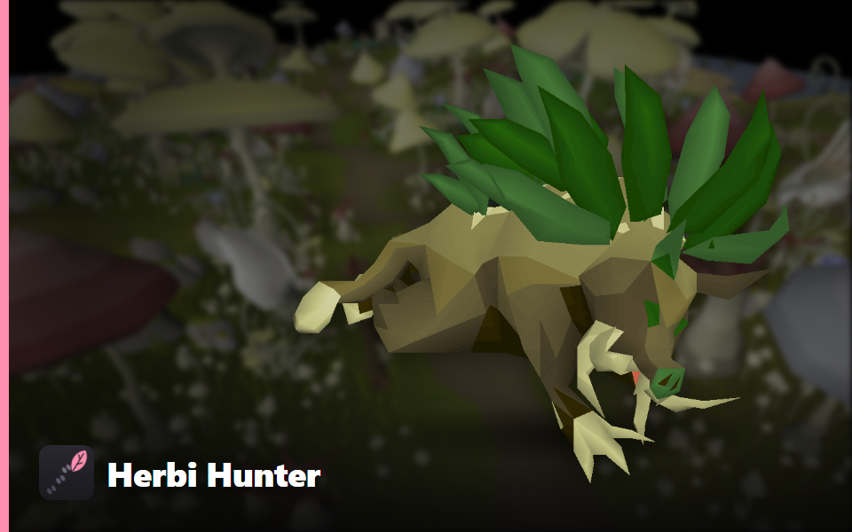

# Herbi Hunter

Hunts herbiboars on Fossil Island: follows the trail, attacks the tunnel, harvests the herbs and banks at the Museum Camp.

## Credits
Built on the Herbiboar plugin by Igor, with work from chsami and Kavraka91. I added the play styles, the humanised mouse and keyboard input and the panel.

## What you need
- 80 Hunter (boosts work)
- 31 Herblore
- Bone Voyage (access to Fossil Island)

## Recommended
- Stamina potions in the bank
- Herb sack and magic secateurs
- 70 Agility for the hole shortcut

Start in the Mushroom Forest on Fossil Island. If you start somewhere else, it sets up at the nearest bank and travels there, using a Digsite pendant when you have one and it saves the walk.

## What it does
- Follows the trail from a start rock to the tunnel, attacks the tunnel and harvests the herbs.
- Banks at the Museum Camp when the inventory is full or a supply runs out.
- Keeps run energy up with your chosen item (stamina, extended stamina, extreme energy, super energy or energy potions, or strange fruit), and can keep the stamina effect going.
- Uses a herb sack and wears magic secateurs if you turn them on.
- Drops the unidentified fossils and grimy herbs you pick. Identified fossils are never dropped.
- When it stands still for a minute it picks the trail back up from the game's state. After three minutes in a row it walks to the camp bank, logs out and stops. At the bank, where standing still is normal, it logs out after three failed tries instead: a visit that does not finish, a herb sack or secateurs slot that will not lock, or auto retaliate that will not turn off.
- **Log out at 99 Hunter** stops it when the level is reached during a session.
- After a disconnect or the six-hour logout it waits a few seconds, logs back in and carries on.
- Keeps session history on the panel, including your best session.

## Play styles
- Relaxed: an unhurried pace that changes from session to session, with short pauses and glances away.
- Focused: quick reactions for when you are watching the screen.

## Breaks
Works with the Break Handler and Break Handler V2. A break only ever starts at the bank: when one is due it finishes the catch, banks, and takes the break there, because a character standing idle in the forest gets attacked. Micro breaks, if you have them on, are only rolled at the bank or the Grand Exchange.

## Settings
Herbi Hunter keeps its own settings, separate from the older Herbiboar plugin, so set your drops and highlights once when you switch.

## Logs
**Log detail** under Setup sets how much goes to `client.log`: Quiet (problems, plus one line when a run starts and stops), Normal (problems and events such as banking and breaks) or Detailed (every step, for a bug report). Every line starts with `[HB-`.

## Restock
With **Buy potions when out** on, it takes coins to the Grand Exchange when the bank has none of your run energy potion left (counted with the bank open, so potions it already bought are never bought again), buys the amount you set (up to 2,000, the Grand Exchange buy limit) at 10% over its price, banks them there and comes back to hunt. Teleports are allowed on this trip only. It never touches your other offers: with every slot in use it logs out and asks you to free one. It only leaves the Grand Exchange once the offer it placed has been collected to the bank. If there aren't enough coins, there's no price, the offer is still unfilled after 3 minutes (it is cancelled) or it cannot be collected, it logs out with the reason. This covers potions only, not strange fruit. With it off, running out logs out.

## Overlay
- Info panel: Full, Compact (what it is doing, catches and rate on one line) or Off. Right-click it to switch.
- Highlights for the start rocks, the next trail spot, the tunnel and the walk route, each with its own colour.
