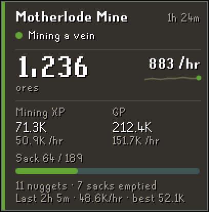

# Motherlode Mine

Mines pay-dirt in the Motherlode Mine, washes it, banks the ore and fixes the water wheels when they stop. It works on both levels.

## Credits

Built on the original [M] MotherlodeMine plugin by Mocrosoft, which is still on the Plugin Hub. These people also worked on it: Nate, See1Duck, Yifan, FunkyMonkeyCloud, Gage307, SandalBandit, Jesufh, George M, Krulvis, mz, Vinícius Rodrigues Silva, runsonmypc, JogOnJohn. I did the rework.

## What you need

- 30 Mining and a pickaxe you have the level for. Wear it, carry it or leave it in the bank.
- For the upper level: 57 Mining and the 100-nugget unlock.
- A hammer, Imcando hammer and gem bag are optional.

## How to start

1. Stand in the mine.
2. Pick a mining area and a deposit method under Setup.
3. If you want Deposit all with a gem bag, read the gem bag section below first.
4. Turn the plugin on.

## What it does

- Mines West Lower, West Mid, South East, South West, West Upper or East Upper. *Any* picks a lower area at random and moves on now and then.
- Fetches the best pickaxe it can use from the bank chest, and checks once per run for a better one. It wears the pickaxe if your Attack level allows and carries it otherwise. Gilded, (or), Trailblazer, 3rd age and crystal pickaxes all count.
- Uses the special attack of dragon, infernal and crystal pickaxes.
- Tracks the sack from the game. If the "sack is full" message or the hopper says it is full, it trusts that over a reading that is still catching up.
- Repairs broken struts, with a hammer from the crate if you don't have one. It can leave the job to another player at the wheel, and takes over if they aren't fixing it.
- Uses the upper hopper if you have it. Emptying the sack and fixing the wheel still mean a climb down.
- Drops gems as they are mined, if you turn that on.
- Can skip veins that another player is standing at on the lower level.
- Keeps your own hammer after a repair. It only drops one taken from the crate.

## When the sack is full

With pay-dirt still in your inventory, it drops the pay-dirt, empties the sack, picks the pay-dirt back up, puts it in the hopper and goes back to mining. The pay-dirt goes first because the ore from the sack needs those slots. It is dropped a few at a time, at a shift-click pace.

It only picks up its own pile, from the tile it was dropped on, and climbs back for one on the other level. It gives up on a pile that has been on the floor too long, is more than about 40 tiles away or won't fit in your inventory.

If a wheel is turning and the hopper still refuses a full load, the sack is full, and the plugin remembers its real size.

## Gem bag and deposit method

Deposit items banks each ore type separately and never touches the gem bag.

Deposit all uses the deposit box button, which would also bank an open gem bag. Turn on *Use gem bag* with it. On the first run the plugin puts the bag in slot 1 and locks that slot at the bank chest. If needed, it turns on the game's inventory slot locks first. The lock stays on between logins, so later runs skip that trip.

If the slot can't be locked, that session uses Deposit items. If the slot becomes unlocked during a run, it deposits item by item until it is locked again.

The bag is emptied into your inventory and banked on each sack trip. Everyday deposits use the deposit box; the bank chest is for fetching items, loading a setup and locking the slot.

With *Use Imcando hammer* on, it wears the hammer in the off-hand. It looks in your equipment, your inventory and then the bank, and falls back to a crate hammer.

## Settings

### Setup

| Setting | What it does |
|---------|--------------|
| Mining area | Where to mine. *Any* picks a lower area at random and moves on now and then. The upper areas need 57 Mining and the upper-level unlock; the plugin stops with a message if you pick one below 57. |
| Use upper hopper | Deposit at the upper hopper when mining upstairs. If the hopper isn't there, it switches to the lower hopper for the rest of the run. |
| Deposit method | Deposit items (per type, always safe) or Deposit all (the box button). Deposit all switches to item by item on any trip where you carry something it would bank, such as a pickaxe, hammer or coal bag. |
| Use gem bag | Withdraw the bag if needed, lock it in slot 1, open it, and empty it into the bank on sack trips. |
| Drop gems | Drop uncut gems as they are mined. Ignored while *Use gem bag* is on. |
| Avoid other players | Lower level only: skip a vein another player is standing at. Off by default. |
| Sack size before login | Panel hint only until the game reports the real sack size. |
| Use inventory setup | Load the chosen Inventory Setups loadout at the bank chest before mining. Stops with a message if it can't. |
| Inventory setup | Which loadout to load. |
| Stop after | Stop after this much play time (0-1440 minutes). Time on a break doesn't count. 0 runs until you stop it. |
| Stop at Mining level | Stop when Mining reaches this level. 0 never stops for a level. |
| Log out when finished | Log out once a stop goal is reached, or when the run stops on a problem it can't fix by itself. On by default. Set-up problems (a level, a setting, a loadout) never log you out. |
| Log detail | How much goes to client.log: Quiet (problems only), Normal, or Detailed (every decision). Takes effect at once. |

### Wheel repair

| Setting | What it does |
|---------|--------------|
| Repair struts | Fix a wheel on a deposit trip once both wheels have stopped. When off, the run parks and waits for another player to fix it. On by default. |
| Use Imcando hammer | Repair with your own Imcando hammer instead of fetching one from the crate. |
| Let others repair | Wait instead of repairing while someone stands at the wheel; take the job back if they turn out to be idle. On by default. |
| Hop when frozen | While waiting on a frozen wheel, hop to the busiest world once the wait passes *Frozen wait*. |
| Frozen wait | How long to wait before hopping (10-900 seconds, default 120). |

### Humanisation

| Setting | What it does |
|---------|--------------|
| Human-like behaviour | Master toggle for the humanisation layer. Turn off for maximum speed. |
| AFK park side | Which screen edge the cursor parks off during AFK bouts — `None` (never leaves the client), `Left`, `Right`, `Top`, `Bottom`, or `Random` (one edge picked per login). |
| Mouse activity | What the cursor does during a bout — see below. |

### Overlay

| Setting | What it does |
|---------|--------------|
| Info panel | Full, Compact (one line) or Off. Right-click the panel to minimise or expand it. |

The full panel shows the play time (logged in and not paused or on a break), what the bot is doing, ores mined with an
ores-per-hour rate and a two-hour sparkline, Mining XP and GP with their rates, how full the sack is,
and nuggets and sacks emptied. Rates show `-` for the first few minutes, until there is enough data
for them to mean something. Once you have played before, the last line shows your last session's
length and XP an hour, and your best XP an hour from sessions of 15 minutes or more. The last 30
sessions are kept, and the running one is saved as it goes, so a client crash still keeps it.

### Mouse activity

| Mode | Cursor leaves the game window | While it stays in the window |
|------|-------------------------------|------------------------------|
| AFK (default) | Every time | No hovering over the next vein and no inventory checks |
| Balanced | About 45-88% of the time, set for each login | Hovers over the next vein, sometimes late, and checks the inventory now and then |
| Active | About 12% of the time | Hovers and checks about twice as often as Balanced |

With *AFK park side* set to None, the cursor rests where it last clicked. Each login gets its own habits, and the mode scales them. Mining runs at a relaxed pace; hopper, sack and wheel trips are quicker.

## Breaks and logging in

- Works with Break Handler and Break Handler V2. A break waits until no pay-dirt is on the floor and no hopper, sack or repair trip is under way. Stop goals wait for the same point.
- After a disconnect or the 6-hour logout it logs back in after a short wait, with longer gaps after a failed try, up to 5 tries. It stays logged out if you logged out yourself, during a break, or when Auto Login is on.
- When it finishes it clicks the logout button after a short pause.
- Your mouse and antiban settings go back to how they were when the plugin stops. With *Overwrite script settings* on in the Antiban panel, it leaves them alone.

## If something goes wrong

If it gets stuck several times, it goes back to a safe tile and starts again. If starting again twice gets it nothing mined, no pay-dirt into the hopper and no ore out of the sack, or 20 minutes of play pass like that, it stops with a message. Breaks, pauses and waiting for a wheel don't count. After "I can't reach that!" it skips that vein for a while.

If three repairs in a row fail, it leaves the wheel alone for a few minutes (long enough to hop, with *Hop when frozen* on) before trying again. If that happens three times without a wheel turning, a deposit or a hop, it stops with a message. With *Repair struts* off it waits as long as it takes.

It also stops with a message when it has no usable pickaxe, an upper area is picked below 57 Mining, the inventory is full of items the deposit box won't take, a loadout won't load, the bank won't close or asks for a PIN it doesn't have, or it can't log back in.

## Good to know

- It doesn't spend nuggets. Buying the bigger sack and upper-level access is up to you.
- Nuggets on the panel are the ones gained this session. Nuggets you already had, carried or banked, don't count.
- Lifetime ores, XP, time, sacks and nuggets are saved between sessions.
