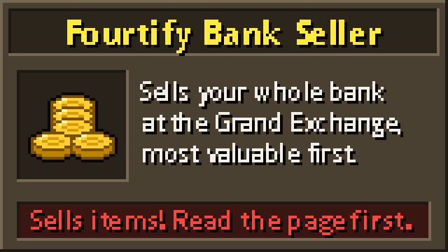

> **WARNING: this plugin sells your items.**
> It sells everything the Grand Exchange accepts, in your bank AND in your inventory. This includes tools, weapons, armour and supplies you carry. It sells whole stacks at 1 coin each, so you get whatever buyers pay, which can be below the guide price. You cannot undo a sale. There is no keep list. Use it only on an account whose items you want to sell.
> It does not sell worn items, coins, bonds or untradeable items.

# Fourtify Bank Seller

Fourtify Bank Seller empties your bank and inventory at the Grand Exchange. Use it to turn a pile of items into coins without selling each one by hand.

## Before you start

- Use Microbot client 2.6.42 or newer.
- Use an account that can trade. Accounts that cannot use the Grand Exchange, such as ironman accounts, cannot use this plugin.
- Stand next to the Grand Exchange, near the Grand Exchange Clerk and a bank booth.
- Clear any bank tag or search in your bank first.
- Remove anything you want to keep from your bank and inventory first. The plugin cannot skip an item.
- Press start. The plugin has no options.

## What it does

1. It opens your bank. It lists all stacks the Grand Exchange accepts and sorts them by total value, highest first.
2. It withdraws stacks as notes until your inventory is full. Items already in your inventory count too.
3. It opens the Grand Exchange and offers each stack for sale, whole, at 1 coin per item. It uses every free offer slot: 3 on a free-to-play account, 8 on a members account.
4. It collects finished sales and repeats until nothing sellable is left.
5. On a free-to-play world, it leaves members items alone.

## When it stops

- It finishes: nothing sellable is left and no offers are waiting.
- A sale was cancelled. Look at the returned items.
- All offer slots hold offers it cannot clear. Free a slot and start again.
- The sale screen shows a warning that does not match the one-coin sale it set up.
- A stack does not fit in your inventory. Free a slot and start again.
- No sale fills, is collected or starts for about 5 minutes. Check your offers.
- Nothing changes for about 2 minutes.
- You die or your hitpoints fall to 20% or less, the game says your bank is full, or a warning screen it does not expect opens.
