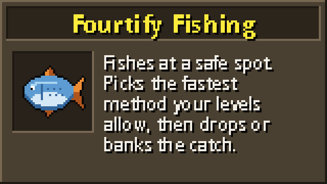

# Fourtify Fishing

Fourtify Fishing trains your Fishing for you. It fetches your tool and bait from the bank, walks to a safe fishing spot, fishes, and drops or banks the catch. It stops at the Fishing level you choose. With "Best available" it picks the method that trains fastest at your level and changes method as you level.

## Before you start

- Use Microbot client 2.6.42 or newer.
- Keep the tool and bait for your method in your bank or inventory. The plugin fetches what is missing (up to 1000 bait at a time). Pearl rods work for their plain rods on members worlds. A harpoon works carried or worn.
- Press start. If you carry items it does not need, it first walks to the nearest bank and deposits them (once per run). It keeps bonds and special items.

## Options

- **Method**: Best available (default) or one fixed method, as in the table. Members methods need a members world.
- **Spot**: Nearest (default) or Random. Random walks to any safe spot on the map. That can be a long walk, and the way there is not checked for danger.
- **Full inventory**: Drop (default) drops raw fish and junk. Bank walks to the nearest bank and back. Karambwanji stack in one slot, so they are banked, never dropped.
- **Target level**: 2 to 99, default 30.

| Method | Fishing level | Members | You need |
|---|---|---|---|
| Small net fishing | 1 (anchovies 15) | no | small fishing net |
| Bait fishing | 5 (herring 10) | no | fishing rod, fishing bait |
| Fly fishing | 20 (salmon 30) | no | fly fishing rod, feathers |
| Pike fishing | 25 | no | fishing rod, fishing bait |
| Harpoon fishing | 35 (swordfish 50) | no | harpoon (or barehanded, see below) |
| Cage fishing | 40 | no | lobster pot |
| Karambwanji fishing | 5 | yes | small fishing net |
| Big net fishing | 16 (cod 23, bass 46) | yes | big fishing net |
| Barbarian fishing | 48, Strength 15, Agility 15 | yes | barbarian rod; fish offcuts, bait or feathers |
| Monkfish fishing | 62 | yes | small fishing net |
| Shark fishing | 76 | yes | harpoon (or barehanded) |
| Infernal eel fishing | 80 | yes | oily fishing rod, bait, ice gloves |
| Anglerfish fishing | 82 | yes | fishing rod, sandworms or diabolic worms |

Barbarian fishing also needs the fishing part of Barbarian Training. Monkfish fishing also needs the quest Swan Song finished, whether you pick it or let Best available choose. Harpoons: dragon and infernal need Fishing 61, crystal 71, and all but the plain harpoon need a members world. Barehanded harpoon fishing needs the barehanded fishing you learn from Otto Godblessed, a members world, and Fishing 55 with Strength 35 for tuna (70 and 50 for swordfish, 96 and 76 for shark). If you own a harpoon, the plugin still uses it.

## What "Best available" does

It rates every method except infernal eel fishing by experience per hour at your real levels (boosts do not count). It counts Fishing experience, plus Strength and Agility for barbarian fishing and Strength for barehanded fishing. It counts only fish you can already catch, with your best harpoon. It runs the best method that can start now: it needs the level, a members world if required, the tool and bait (carried, worn or in the bank) and a safe spot. Barbarian fishing needs Barbarian Training, and monkfish need Swan Song finished. The method already running counts 10% higher, so a small gain does not cost you a bank trip. When you level up or run out of bait, it checks again. A change banks the old tool and catch and fetches the new ones.

## What it checks before it goes

A chosen method and "Best available" check the same things, so neither walks to a place you cannot use. Besides the level, the members world, the tool and the bait, they check:

| What | You need |
|---|---|
| Monkfish fishing | The quest Swan Song finished |
| Barbarian fishing | The fishing part of Barbarian Training |
| The Fishing Guild's lobster and shark docks | Fishing 68 |
| Corsair Cove resource area (lobster, tuna and swordfish) | The quests Dragon Slayer I and The Corsair Curse finished |
| Corsair Cove, south-west of the town (net and bait fishing) | The quest The Corsair Curse finished |

Levels are your real levels. A temporary boost (such as from a potion) does not count for an entry requirement, even where the game would let it. If every spot of the method you chose is shut, the plugin stops before it walks anywhere and tells you which quest or level is missing.

## Staying safe

- It skips spots with aggressive monsters too strong for your combat level.
- It never drops or banks clue bottles, caskets, big bass, big swordfish, big sharks or skilling pets. It never drops bait.
- It never drops, deposits or withdraws bonds.
- It dismisses random events and turns run on when you have the energy.

## When it stops

- You reach your target level.
- It says "Nothing to do" and lists what is missing: level, members world, tool, bait or a safe spot. A fixed method with no bait left ends this way. Restock and start again.
- Your inventory is full of items it does not drop or bank. Free some space and start again.
- You die, or your hitpoints fall to 20% or less. The plugin carries no food.
- The game says your bank is full, or a warning screen opens that the plugin does not expect.
- You do not move, gain experience or change your items for about 5 minutes.
