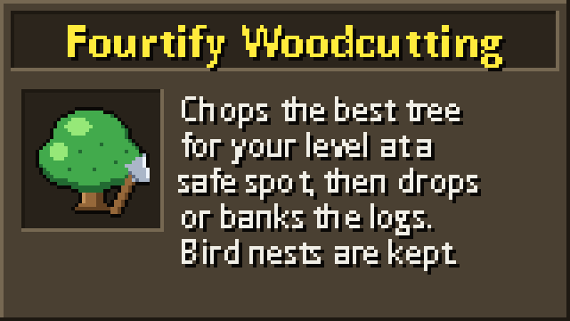

# Fourtify Woodcutting

Fourtify Woodcutting trains your Woodcutting for you. It walks to a safe tree spot, chops until your inventory is full, then drops or banks the logs. It keeps going until you reach the level you choose. With "Best available" it always picks the tree that trains fastest at your level and moves up as you level.

## Before you start

- Use Microbot client 2.6.42 or newer.
- Carry or wear an axe you can use, or keep one in your bank. If you carry none, the plugin fetches the best one from the bank. Axes need these Woodcutting levels: bronze and iron 1, steel 6, black 11, mithril 21, adamant 31, rune and gilded 41. Dragon, infernal and 3rd age axes (61), crystal axes (71) and the felling axes work on members worlds only.
- Start the plugin from the plugin panel. If you carry items it does not need, it first walks to the nearest bank and deposits them (once per run). It keeps your axe, bonds and special items.
- Then it walks to a tree spot, chops, and handles the logs as you chose.

## Options

- **Tree**: Best available (default), Tree, Oak tree, Willow tree, Teak tree, Maple tree, Mahogany tree, Arctic pine tree, Yew tree, Camphor tree, Magic tree, Ironwood tree, Redwood tree or Rosewood tree. A fixed tree needs its level. Free-to-play trees are Tree, Oak, Willow, Maple and Yew. All others need a members world.
- **Spot**: Nearest (default) walks to the closest safe spot. Random walks to any safe spot on the map. Random can mean a long walk, and the plugin does not check the way there for danger.
- **Full inventory**: Drop (default) drops the logs where you stand. Bank walks to the nearest bank, deposits the logs and walks back.
- **Target level**: 2 to 99, default 30. The plugin stops at this Woodcutting level.

Tree levels: Tree 1, Oak 15, Willow 30, Teak 35, Maple 45, Mahogany 50, Arctic pine 54, Yew 60, Camphor 66, Magic 75, Ironwood 80, Redwood 90, Rosewood 92.

## What "Best available" does

It picks the tree with the most Woodcutting experience per hour. It uses your real Woodcutting level (boosts do not count), your world, and the best axe you carry, wear or keep in the bank. It leaves out trees above your level, members trees on a free-to-play world, trees and spots you cannot enter yet (see "What it checks before it goes") and trees with no safe spot. If two trees tie, the higher one wins. The higher tree is not always faster. Arctic pines give less experience than mahogany, and a yew gives logs less often than a willow when you have a good axe.

## What it checks before it goes

A chosen tree and "Best available" check the same things, so neither walks to a place you cannot enter. A spot is used only when you meet every requirement of its area:

| Where | You need |
|---|---|
| Woodcutting Guild trees | Woodcutting 60 |
| Camphor trees (the Great Conch) | Sailing 45 and Troubled Tortugans started |
| Ironwood trees | Sailing 72 |
| Rosewood trees | Sailing 79 |
| Miscellania maples | The Fremennik Trials finished and Throne of Miscellania started |
| Etceteria teak and mahogany | The Fremennik Trials and Royal Trouble finished |
| Neitiznot arctic pines | The Fremennik Trials finished and The Fremennik Isles started |
| Mos Le'Harmless teak and mahogany | Cabin Fever finished |
| Zanaris trees | Lost City finished |
| Prifddinas and the Gwenith area trees | Song of the Elves finished |
| Corsair Cove resource area (yew and maple) | Dragon Slayer I and The Corsair Curse finished |

Levels are your real levels. A temporary boost (such as from a potion) does not count for an entry requirement, even where the game would let it. If every spot of the tree you chose is shut, the plugin stops before it walks anywhere and tells you which quest or level is missing.

## Staying safe

- It skips spots with aggressive monsters that are too strong for your combat level.
- It never drops or banks clue scrolls, clue nests, bird nests, caskets, geodes, big fish or skilling pets. It picks up nests that fall within 5 tiles of you.
- It drops only the logs of trees. It never drops, deposits or withdraws bonds.
- It never chops Wilderness trees and never confirms the Wilderness warning.
- It dismisses random events and turns run on when you have the energy.

## When it stops

- You reach your target level (if you start at or above it, it stops at once).
- It says "Nothing to do" and lists what is missing, such as no usable axe, too low a Woodcutting level for the chosen tree, a members tree on a free world, or no safe spot. Fix that and start it again.
- Your inventory is full of nests and holds no logs. Free some space and start again.
- You die, or your hitpoints fall to 20% or less. The plugin carries no food.
- The game says your bank is full, or a warning screen opens that the plugin does not expect.
- Nothing changes for a few minutes (no move, no experience, no items).
