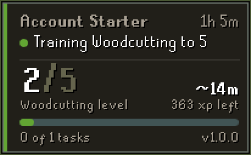

# Account Starter

I wrote this to set up a fresh free-to-play account for me. It works through the Combat and Gatherer **Adventure Paths**, claims every reward, and does **Mudfoot's Big Adventure** along the way. On a main account, turn on **Quest only** and it just does the quest.

## Credits
- chsami and the Microbot contributors, for the client and the APIs this is built on.
- The OSRS Wiki, for the task, reward and quest details.

## What you need
- An account that told the Gielinor Guide it is new or returning (so Adventure Paths are on). Not an ironman.
- Start in Lumbridge if you can. Adventurer Jon stands there.
- Quest only has neither limit: it works on any account that hasn't done the quest, members worlds included.

## What it does
- Gets the Combat path starter kit from Adventurer Jon and opens it.
- Trains Attack, Strength, Defence, Ranged, Magic, Fishing, Woodcutting and Mining to the task levels (5, 10 and 20 for combat, 5 for gathering) at free-to-play spots around Lumbridge.
- Picks up free tools from the Lumbridge tutors (Finlay, Wilfred and Monlum), sorts the kit at the bank, and buries bones as it loots them.
- Does Mudfoot's Big Adventure once melee is done and before Ranged and Magic. The quest gives a bow, arrows, a staff, runes, 500 coins and four combat lamps.
- Claims finished task rewards from Jon, uses the Lamp of the Gatherer on your lowest chosen gathering skill, claims the Combat path voucher rewards from the Varrock NPCs and banks them. It can log out when it's finished.
- Sets the task it's working on as the in-game focus, like you would.
- Remembers where each account got to, so it carries on when you turn it back on.
- Works with either break handler: it finishes a fight or a conversation first, then lets the break start. If you get logged out and Auto Login is off, it logs back in with your Microbot profile.

## Paths
- **Everything**: every Combat and Gatherer task.
- **Skiller (gathering only)**: Fishing, Woodcutting and Mining only. Hitpoints and the combat skills stay untouched.
- **Combat only**: just the combat tasks.
- **Choose skills**: set a target for each skill in the Choose skills section, or Off to leave it alone.

## Task order
- **Smart order**: picks the cheapest next step, for example a task whose reward another task needs.
- **Whole set**: finishes one skill before starting the next.
- **Path by path**: gathering first, then combat.
- **Mix it up**: switches skills in timed blocks.

## Quest only (main account)
Skips Adventure Paths and works on members worlds. It checks the bank, takes a staff and runes for the best strike spell the account can cast, does Mudfoot's Big Adventure with magic, and stops. Quest lamps are only used if you pick a skill in **Quest lamps**.

## Food
When a fight needs food and there's none cooked, it takes raw fish from the bank or catches some (by level and the tools you own), then cooks it beside the fishing spot on a fire it lights, or on the Lumbridge kitchen range once Cook's Assistant is done. With **Cook food** off it only uses cooked food, and Cooking and Firemaking stay untouched.

## Arrows and runes
After Mudfoot's Big Adventure, Captain Harlan hands out a shortbow and 40 bronze arrows, or a staff with air and mind runes, every 30 minutes. Between claims, **Buy at Varrock shops** walks to Lowe's Archery Emporium for arrows or Aubury's Rune Shop for runes and pays with your coins.

**Pick up arrows** collects your own arrows near each Ranged kill.

## Panel
Shows the current task, progress, what it's doing, the next step and why, parked tasks and why, rewards waiting at Jon, the session time and the version. Right-click it to switch between full and compact.

## Safety rules
- Never goes into the Wilderness. Unsafe routes are refused, and if it ever ends up there it walks out and stops.
- Never uses the Grand Exchange, never trades with other players, and closes trade windows.
- Skills you leave out never get XP. If one ever does, it stops and tells you which.
- With Hitpoints left out, auto-retaliate is turned off so a hit back can't give XP.
- It starts every fight itself, in a safe style.
- When something fails a few times it parks that task with the reason and moves on, or stops and says why.
- Never changes your client's antiban settings.
- Never banks the Lamp of the Gatherer or uses it on a skill you didn't choose.
- Never picks a dialogue option it doesn't recognise.

## Known limits
- Warrior, Wizard and Ranger path accounts aren't supported yet; those tasks are parked.
- Free-to-play worlds only. It stops on a members world unless Quest only is on, so members rewards stay with Jon.
